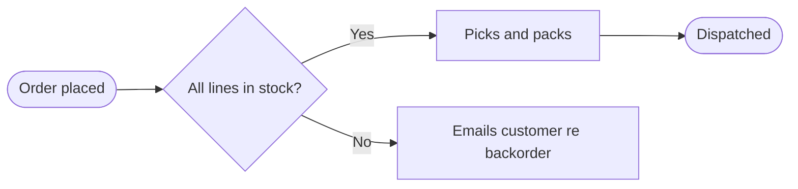

# Process Mapping Notations — Practitioner's Notes

*A quick reference for the notation conventions used in this toolkit. Not a formal BPMN course — just the shapes I actually use, the conventions I stick to, and the stuff people get wrong.*

---

## Pick a level and stay there

Before drawing anything, decide what the map is *for*. Three levels, and mixing them in one map is the most common way maps become unreadable:

| Level | What it shows | Audience | Detail per step |
|---|---|---|---|
| **Context / SIPOC** | The process in 5–7 high-level blocks | Sponsors, steering groups | One box = many steps |
| **Working map** *(this toolkit's default)* | Steps, roles, systems, decisions | Project team, workshop room | One box = one action by one role |
| **Procedure / work instruction** | Click-level instructions | End users, training | Screen and field level |

If someone asks you to add click-level detail to a working map, that's a separate artefact, not a bigger map.

## The shapes I actually use (BPMN-lite)

Full BPMN has 100+ symbols; projects need about seven. Anything beyond this and reviewers stop reading:

```
 ┌───────────────┐     ┌───────────────┐
 │ Rounded box   │────▶│ Rounded box   │     Process step (verb-first: "Picks order")
 │  = an action  │     │               │
 └───────────────┘     └───────────────┘

        ◯                                             Start event ("Order placed")
        ◎                                             End event ("Order closed")
                                                       (double ring = end)

        ◇                                             Decision / gateway
       / \        Yes                                  ("All lines in stock?")
      /   \───▶
     /     \───▶  No

   ┌╌╌╌╌╌╌╌╌╌┐                                        Data / document
   └╌╌╌╌╌╌╌╌╌┘                                        ("Pick list", "Dispatch note")

   ▭▭▭▭▭▭▭▭▭▭▭                                        System (thin rectangle or
                                                        labelled [bracket] — pick one
                                                        convention and stick to it)

   ─ ─ ▶  dashed arrow = data/document flow ("emails note")
   ───▶   solid arrow  = work/handoff flow ("order moves to warehouse")
```

**Rule of thumb:** if a reader can't tell in 3 seconds what a shape means, you've used a shape they don't know. Legend on every map — no exceptions.

## Swimlanes

- **One lane per role** (or per team for cross-team processes; per system only for system-integration maps).
- **Horizontal lanes** for most business processes (reads top-to-bottom, left-to-right); vertical pools when you're mapping across organisations (e.g. us vs carrier).
- **Every step sits in exactly one lane** — the lane of whoever *does* it. "The system and the warehouse confirm the order" is two steps.
- **Arrows crossing lane boundaries are handoffs.** Make them prominent and count them. Handoff count before/after is the single most persuasive number a process map produces.
- **Swimlanes ≠ flowchart columns.** If the same person does two adjacent steps, they're in the same lane even if the arrow loops back.

## Conventions I always keep

1. **Verb-first step names.** "Checks stock", not "Stock check". Verbs expose duplicate steps and missing owners.
2. **One verb per box.** "Picks, packs and dispatches" is three steps. Splitting them is how you find the wait between pick and pack.
3. **Decisions have exactly two labelled exits** (Yes/No, or the actual options: "In stock? / Backorder"). Three-way unlabelled diamonds are where discussions stall.
4. **Every path reaches an end event.** If a branch just stops, either it's wrong or you've found an orphan process — both worth knowing.
5. **Name the system inside the step** ("Checks stock *in WMS*") or via a system lane — but not both, and not neither.
6. **Start events are triggers, not departments.** "Order placed", not "Customer".
7. **Time annotations are first-class.** Waits ("⏳ 2 days"), durations ("3–5 min"), and SLAs ("≤ 4 hrs") go on the map. Real lead time lives in the waits, and an unannotated map hides the most expensive problem in the process.
8. **Pain points are marked, not buried.** This toolkit uses ⚠ on the map plus a column in the step list. The marks are the raw material for the gap analysis.

## Flowchart vs BPMN — when to use which

| Situation | Use |
|---|---|
| Workshop wall map, business audience | **Flowchart / BPMN-lite** (this page). Everyone can read it without training. |
| Formal process documentation for audit or a BPM platform | **Full BPMN 2.0** — events, gateways and pools get their formal meanings; a BPMN-literate reviewer will call out informal usage. |
| Quick decision logic only (a rule, a validation) | **Decision table** beats a diagram (see the rule-table pattern in the [user story template](../templates/user-story-template.md)). |
| System-to-system data flow | **Context/data-flow diagram** — process maps bury interfaces. |

Honest note: I've seen full-BPMN projects fail review because the team argued about whether something was a "service task" or a "user task". If your audience isn't BPMN-certified, BPMN-lite with a legend is more useful and less dogmatic.

## Common mistakes (and the fix)

| Mistake | Why it hurts | Fix |
|---|---|---|
| Mapping the procedure, not the process | The real process — the one with the wait times — never gets analysed | Ask "what actually happens?" and map that; note the variance |
| Rhombus for everything | Decisions lose meaning when everything's a decision | Decisions split paths; if the path doesn't split, it's a step |
| Steps with no owner | Nobody can fix a step nobody owns | Lane placement forces ownership |
| Unlabelled arrows out of decisions | Reviewers guess the logic; bugs get built on guesses | Label every branch |
| Detail zoom-level drift across the map | "Pick order" next to "Email template must include order number and expected date" | One level per map; split if you must show both |
| Missing exception paths | The happy-path map describes a world that doesn't exist | At least one exception branch per map; ask for it explicitly |
| No legend / version / date | The map outlives the context and gets misread later | Header block on every map: title, version, date, author |

## Mermaid quick-start (the notation in this repo)

The maps in the examples are drawn in ASCII for portability, but if you want version-controllable diagrams, mermaid in markdown is the sweet spot:

````

````

Keep the same conventions inside mermaid: verb-first, one action per node, labelled branches, `([rounded])` for events, `{}` for decisions, `[]` for steps.

---

*Notation exists so a stranger can read your map and argue with it correctly. If your map needs a 10-minute explanation to be understood, the notation is working against you.*
